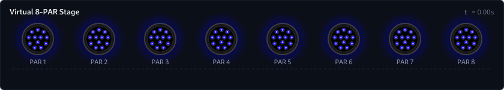
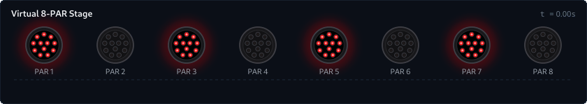
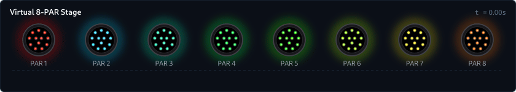
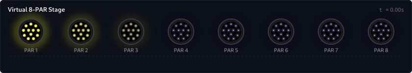
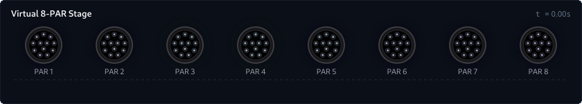

# Lightshow DSL Guide & Language Reference

`lightshow` is a composable, algebraic Python framework for designing DMX and Art-Net lighting shows.

Traditional lighting programming often suffers from imperative spaghetti code: manual byte arrays, hardware tick loops, and scattered timing variables. `lightshow` replaces this with a **declarative, functional timeline**:

1. **Continuous Time**: Every clip and scene is mathematically modeled as a continuous function $f(t) \to \text{State}$, evaluated cleanly at any frame rate (30 Hz, 40 Hz, 60 Hz).
2. **Algebraic Composition**: Complex lighting shows are constructed by composing clips and scenes using standard Python operators (`>>` for sequencing, `|` for layering, `*` for repetition, `@` for time scaling, and `~` for inversion).
3. **Decoupled Hardware**: Physical DMX channels are abstracted into reusable fixture profiles (`EurolitePartySpot`, `EuroliteBCL40Bar`), while visualizer engines render authentic 2D stage faces and timelines directly in Python and Jupyter notebooks.

---

## 1. The Tutorial Rig: 8 RGBW PARs

To illustrate the language concepts simply and step-by-step, all examples in this guide use a clean stage setup with **8 identical RGBW LED PARs** (`EurolitePartySpot` fixtures, 6 DMX channels each: RGB, White, Master Dimmer, Strobe).

```python
from lightshow import FixtureGroup
from lightshow.profiles import EurolitePartySpot, Stage

# 1. Create a group of 8 PARs (Channels 1..6, 7..12, 13..18, ..., 43..48)
PARS = EurolitePartySpot.group(
    "PARS",
    start_channels=[1 + i * 6 for i in range(8)],
)

# 2. Configure a 2D Virtual Stage for SVG rendering and Jupyter scrubbing
STAGE = Stage(
    width=840,
    height=150,
    title="Virtual 8-PAR Stage",
    fixtures=[
        EurolitePartySpot(PARS[i], x=63 + i * 102, y=65, radius=26, label=f"PAR {i+1}")
        for i in range(8)
    ],
)
```

With this rig defined:
- `PARS(clip)` binds any clip or animation to all 8 PARs.
- `STAGE.render_svg(scene, t=1.0)` renders the virtual stage at time $t$.
- In Jupyter, typing `scene` or `STAGE(scene, t=1.0)` renders an immediate visual preview, and `STAGE.inspect(scene)` provides an interactive scrubber widget.

---

## 2. Core Building Blocks (Clips)

A `Clip` represents a time-varying light pattern independent of physical hardware.

### Foundational Clips

- **`Hold(color, duration=inf, [w, ww, cw, dimmer, strobe])`**:
  Maintains constant color and channel levels.
  ```python
  Hold(Color.BLUE)                        # Infinite steady blue
  Hold(Color.RED, duration=2.0)           # 2-second red
  Hold(Color.WHITE, w=1.0, dimmer=0.5)    # Warm white at 50% brightness
  Hold(Color.YELLOW, strobe=0.8)          # Yellow with hardware strobe active
  ```

- **`Fade(start_color, end_color, duration=1.0, ease=Ease.linear)`**:
  Smoothly interpolates color and brightness from `start_color` to `end_color`.
  ```python
  Fade(Color.BLACK, Color.CYAN, duration=1.5)
  Fade(Color.BLUE, Color.MAGENTA, duration=2.0, ease=Ease.in_out_sine)
  ```

- **`Pulse(color, duration=1.0, low=0.0, high=1.0, ease=Ease.in_out_sine)`**:
  Breathing effect: swells up from `low` to `high` and decays back down.
  ```python
  Pulse(Color.CYAN, duration=1.0)
  Pulse(Color.WHITE, high=0.6, duration=0.5)  # Soft flash
  ```

- **`Rainbow(duration=4.0)`**:
  Rotates smoothly through the full 360° color wheel over `duration` seconds.

- **`Gradient(colors, duration=4.0)`**:
  Smooth multi-stop gradient transition passing through a list of colors.
  ```python
  Gradient([Color.PURPLE, Color.BLUE, Color.CYAN, Color.PURPLE], duration=3.0)
  ```

- **`Wait(duration)`**:
  A transparent pause for `duration` seconds. It leaves underlying channels untouched when layered over another scene.

- **`Blackout(duration=inf)`**:
  Actively zeroes out all color and intensity channels.

### Example 1: Basic Transitions (`Fade` $\rightarrow$ `Pulse` $\rightarrow$ `Hold`)

Chaining clips sequentially using the `>>` operator:

```python
scene = PARS(
    Fade(Color.BLUE, Color.MAGENTA, duration=1.0)
    >> Pulse(Color.CYAN, duration=1.0)
    >> Hold(Color.AMBER, duration=0.8)
)
```



---

## 3. Time Composition Operators

`lightshow` uses Python operator overloading to provide a clean algebra for time manipulation:

| Operator | Method / Class | Meaning | Example |
| :--- | :--- | :--- | :--- |
| `>>` | `SequenceClip` / `SequenceScene` | **Sequence (Then)**: Play A, then play B | `A >> B >> C` |
| `* n` | `RepeatClip` / `RepeatScene` | **Repeat (Loop)**: Repeat pattern $n$ times | `Pulse(Color.RED) * 4` |
| `[start:stop]` | `SliceClip` / `SliceScene` | **Time Slice (Cut)**: Extract sub-range $[t_{\text{start}}, t_{\text{stop}}]$ | `clip[0.3:1.2]` |
| `@ dur` | `TimeScaleClip` / `TimeScaleScene` | **Time Scale (Stretch/Compress)**: Force duration to `dur` | `Rainbow() @ 10.0` |
| `/ factor` | `TimeScaleClip` | **Speed Up / Slow Down**: Scale time playback speed | `clip / 2.0` (twice as fast) |
| `~` | `ReverseClip` / `ReverseScene` | **Reverse**: Play backwards in time | `~Fade(Color.RED, Color.BLUE)` |

### Time Slicing & Cutting (`clip[start:stop]` or `.cut()`)

Any clip or full scene can be time-sliced using standard Python slice notation `[start:stop]` or `.cut(start, stop)`:

```python
# Cut the [0.3s, 1.2s] window from a 4-second animation (duration becomes 0.9s):
segment = Rainbow(duration=4.0)[0.3:1.2]

# Repeat that cut segment indefinitely:
infinite_loop = segment * inf
# or equivalently:
infinite_loop = segment.loop()

# Slicing works identically on full multi-fixture scenes:
cut_scene = my_scene[0.3:1.2] * inf
```

### Looping and Infinite Playback

Clips can be repeated finite times or indefinitely:
```python
pattern = Pulse(Color.CYAN, duration=0.5) >> Wait(0.5)

# 4 repetitions (total 4.0s)
four_times = pattern * 4

# Infinite loop (for live streaming)
infinite = pattern * inf
# or equivalently:
infinite = pattern.loop()
```

### Automatic Reverse and Ping-Pong

Any clip can be inverted with `~` or ping-ponged back and forth:
```python
# Plays forward, then immediately plays backward
sweep = Fade(Color.RED, Color.BLUE, duration=1.5).pingpong()  # 3.0s total
```

---

## 4. Spatial Composition & Layering

Lightshows become visually compelling when different lights perform distinct roles simultaneously.

### The Layering Operator (`|`)

The pipe operator `|` runs clips or scenes concurrently:
```python
scene = SceneA | SceneB
```
When two clips drive the same fixture at the same time, `lightshow` uses **LTP (Last-Takes-Precedence / Override)** by default: the top layer overrides the bottom layer.

### Sub-Targeting with `.on(*indices)`

Any clip can be restricted to specific fixtures using `.on(*indices)`:

```python
# Target evens (0, 2, 4, 6) with steady Red
evens = Hold(Color.RED, duration=2.4).on(0, 2, 4, 6)

# Target odds (1, 3, 5, 7) with pulsing Cyan
odds = (Pulse(Color.CYAN, duration=1.2) * 2).on(1, 3, 5, 7)

# Layer them together across the 8 PARs:
scene = PARS(evens | odds)
```



### Fixture Slicing and Group Concatenation

`FixtureGroup` objects behave like Python lists and support slicing, indexing, and concatenation:

```python
# Slice stage halves
STAGE_LEFT  = PARS[:4]    # PAR 1, 2, 3, 4
STAGE_RIGHT = PARS[4:]    # PAR 5, 6, 7, 8

# Center vs Wings
CENTER = PARS[2:6]        # PAR 3, 4, 5, 6
WINGS  = PARS[:2] + PARS[6:]  # PAR 1, 2 and 7, 8

# Reverse physical order (Right to Left)
REVERSED = PARS[::-1]

# Drive independently in parallel:
scene = (
    STAGE_LEFT(Hold(Color.BLUE, duration=2.0))
    | STAGE_RIGHT(Hold(Color.ORANGE, duration=2.0))
)
```

---

## 5. Spatial Transforms & Distribution

Rather than manually programming delays for every light, `lightshow` provides high-level spatial operators:

### Spatial Phase Spread (`.spread()`)

Calling `.spread()` on a clip calculates continuous phase offsets across all fixtures in the group:

```python
# Without .spread(): All 8 PARs show the exact same color in unison
unison = PARS(Rainbow(duration=2.4))

# With .spread(): The color wheel spreads across the 8 PARs as a moving wave!
wave = PARS(Rainbow(duration=2.4).spread())
```



### Marquee Chases (`Chase`)

`Chase` creates a classic marquee sweep across fixtures with customizable speed, trail falloff, and background glow:

```python
chase = Chase(
    color=Color.YELLOW,
    step_duration=0.15,
    tail=2.0,                                    # Soft 2-fixture decay trail
    background=Color.from_hex("#0d0033"),        # Deep indigo ambient background
).pingpong()                                     # Bounce left <-> right cleanly across stage

scene = PARS(chase @ 2.4)
```



> [!NOTE]
> **Circular Loops vs. Linear Boundaries (`wrap=True/False`)**:
> By default, `Chase(..., wrap=True)` uses circular modulo arithmetic—ideal for circular trusses or looping marquee rings where the trail wraps around from fixture 0 back into fixture 7.
> When using `chase.pingpong()`, the engine automatically enforces linear boundaries (`wrap=False`) so the moving spot and its decay trail bounce off the stage walls with complete spatial symmetry and zero edge bleed.

### Stagger and Mirror Transforms

- **`.stagger(delay)`**: Offsets the start time of each successive fixture by `delay` seconds.
- **`.mirror()`**: Reflects the left half of the stage onto the right half, creating outward or inward symmetric ripples.

```python
# Fire a pulse that ripples outward from the center to the edges:
ripple = Pulse(Color.MAGENTA, duration=0.8).stagger(0.1).mirror()
```

---

## 6. Modulation, LFOs & Hardware Attributes

In addition to RGB color mixing, `lightshow` can modulate discrete hardware channels:

### Low Frequency Oscillators (LFOs)

- **`SineLFO(freq, min_val=0.0, max_val=1.0)`**: Continuous harmonic sine wave.
- **`DimmerLFO(freq, min_val=0.2, max_val=1.0)`**: Modulates master fixture brightness.

```python
# Shimmering cyan wash:
shimmer = Hold(Color.CYAN) | DimmerLFO(freq=2.0, min_val=0.3, max_val=1.0)
```

### Strobe Control & White Diodes

`Hold` and `Pulse` accept explicit hardware channel parameters:
```python
# White channel only (warm/cold white diode mixing without RGB):
pure_white = Hold(Color.BLACK, w=1.0)

# Colored hardware strobe (flickers in the active color):
red_strobe = Hold(Color.RED, strobe=0.85, duration=0.5)
```

---

## 7. Putting It All Together: A Multi-Layer Mini Lightshow

This example combines:
1. **Layer 1 (Base)**: An ambient, moving 4-color gradient spread across all 8 PARs.
2. **Layer 2 (Rhythm)**: A continuous brightness pulse modulating fixture dimmer from 25% to 100% on the beat.
3. **Layer 3 (Accent)**: A sudden strobe burst firing on the outer bookends (PAR 1 & 8 in Red) and center cluster (PAR 4 & 5 in White) at the 2.4s drop.

```python
mini_show = PARS(
    # Layer 1: Ambient color wave
    Gradient([Color.PURPLE, Color.BLUE, Color.CYAN, Color.PURPLE], duration=3.0).spread()
    
    # Layer 2: Rhythmic master pulse modulating dimmer from 25% to 100%
    | (Pulse(1.0, low=0.25, high=1.0, duration=0.6, channel="dimmer") * 5)
    
    # Layer 3: Strobe hit at 2.4 seconds
    | (
        Wait(2.4)
        >> (
            Hold(Color.RED, strobe=0.9, duration=0.6).on(0, 7)      # Bookends (Red strobe)
            | Hold(Color.WHITE, strobe=0.9, duration=0.6).on(3, 4)  # Center (White strobe)
        )
    )
)
```



> [!TIP]
> **Channel Independence & LTP Overrides**:
> Notice that Layer 2 targets `channel="dimmer"`. Because it only modulates the master dimmer and leaves `color=None`, the underlying RGB gradient from Layer 1 shines through cleanly while pulsating in brightness.
>
> If Layer 2 had instead pulsed an RGB color like `Color.WHITE`, the top layer's RGB values would have overridden the bottom layer's gradient colors (since `|` uses Last-Takes-Precedence for any non-empty channel). By targeting discrete channels (`"dimmer"`, `"w"`, `"strobe"`), different layers can control different optical dimensions of the same fixture simultaneously!

---

## 8. Jupyter Notebook & Live Streaming

To use `lightshow` interactively in a Jupyter notebook without touching raw UDP sockets:

```python
# Import all DSL symbols and Jupyter visualization tools:
from lightshow.jupyter import *
from my_rig import STAGE, PARS
```

### Interactive Scrubber Widget
Evaluate any scene in an interactive HTML5/JS slider to scrub time back and forth at full fidelity:

```python
STAGE.inspect(mini_show, duration=3.0, fps=15)
```

### Background Streaming (Hot-Reloadable)
Send Art-Net UDP packets directly to your physical fixtures in a non-blocking background thread:

```python
# Start streaming in the background at 40 Hz:
stream(mini_show)

# Seamlessly hot-swap to a new cue on the fly (no restart needed!):
stream(PARS(Rainbow(duration=2.0).spread()))

# Stop streaming when done:
stop_stream()
```

---

## 9. Quick Reference Cheat Sheet

### Operators on `Clip` and `Scene`

| Expression | Name | Description |
| :--- | :--- | :--- |
| `A >> B` | Sequence | Play `A`, followed immediately by `B`. |
| `A \| B` | Layer | Play `A` and `B` simultaneously (LTP override). |
| `A ^ B` | Additive Blend | Layer with additive RGB photon mixing. |
| `A * n` | Repeat | Loop `A` for $n$ cycles (use `n = inf` for infinite loop). |
| `A[start:stop]` | Time Slice (Cut) | Extract sub-range $[t_{\text{start}}, t_{\text{stop}}]$ from clip or scene. |
| `A @ dur` | Time Scale | Rescale playback so total duration equals `dur` seconds. |
| `A / factor` | Speed Scale | Multiply playback speed by `factor` (`A / 2.0` = 2x speed). |
| `~A` | Reverse | Play `A` backwards in time. |
| `group(clip)` | Bind | Bind a `Clip` to a `FixtureGroup`, producing a `BoundScene`. |
| `g1 + g2` | Group Concat | Combine multiple fixture groups into a single layout. |
| `g[start:stop]` | Group Slice | Slice fixture elements by index (e.g. `PARS[:4]`, `PARS[::-1]`). |

### Built-in Clips

| Clip | Arguments | Description |
| :--- | :--- | :--- |
| `Hold` | `color=Color.WHITE, duration=inf, [w, ww, cw, dimmer, strobe]` | Steady state output. |
| `Fade` | `start_color, end_color, duration=1.0, ease=Ease.linear` | Linear or eased color crossfade. |
| `Pulse` | `color_or_peak=1.0, duration=1.0, low=0.0, high=1.0, ease=...` | Breathing swell and decay. |
| `Rainbow` | `duration=4.0` | 360° chromatic hue revolution. |
| `Gradient` | `colors: list[Color], duration=4.0` | Multi-stop color blend. |
| `Chase` | `color, step_duration=0.1, tail=1.0, background=Color.BLACK` | Stepping marquee chase. |
| `Wait` | `duration` | Non-destructive pause. |
| `Blackout` | `duration=inf` | Forces all channels to 0. |
| `SineLFO` | `freq=1.0, min_val=0.0, max_val=1.0` | Sinusoidal value oscillator. |
| `DimmerLFO` | `freq=1.0, min_val=0.0, max_val=1.0` | Sinusoidal dimmer modulation. |

### Clip Modifiers & Methods

| Method | Description |
| :--- | :--- |
| `clip.on(*indices)` | Restrict animation to specific 0-based fixture indices. |
| `clip.spread()` | Distribute phase across all fixtures in the group evenly. |
| `clip.stagger(delay)` | Shift start time of each successive fixture by `delay` seconds. |
| `clip.pingpong()` | Play clip forward, then immediately backward (`clip >> ~clip`). |
| `clip.reverse()` | Invert playback direction (equivalent to `~clip`). |
| `clip.mirror()` | Symmetrically reflect animation from center outward. |
| `clip.loop(n=inf)` | Repeat clip $n$ times (default infinite). |
| `clip.dim(factor)` | Scale overall brightness by `factor`. |
