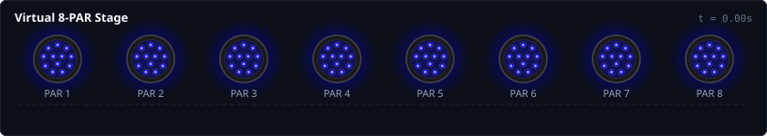
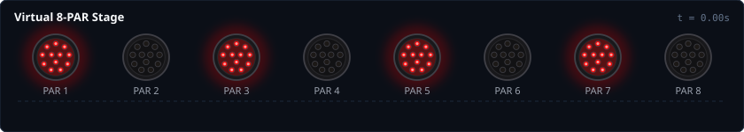
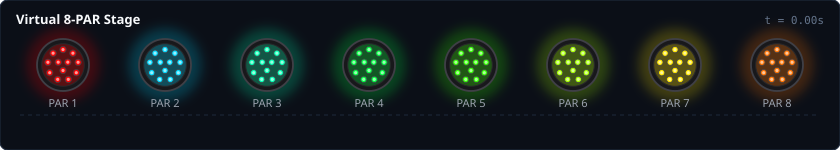
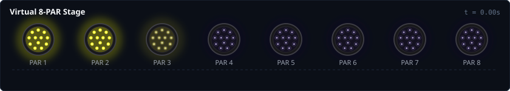
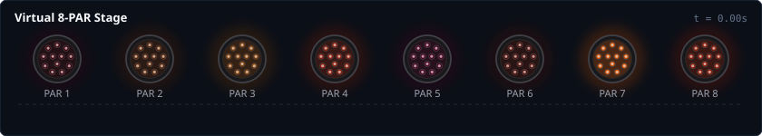
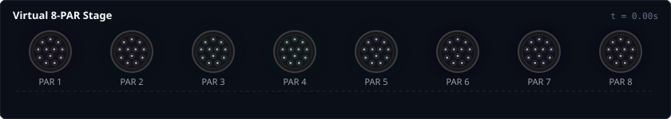

# Lightshow DSL Guide & Language Reference

`lightshow` is a composable, algebraic Python framework for designing DMX and Art-Net lighting shows.

Traditional lighting programming often suffers from imperative spaghetti code: manual byte arrays, hardware tick loops, and scattered timing variables. `lightshow` replaces this with a **declarative, functional timeline**:

1. **Continuous Time**: Every clip and scene is mathematically modeled as a continuous function $f(t) \to \text{State}$, evaluated cleanly at any frame rate (30 Hz, 40 Hz, 60 Hz).
2. **Algebraic Composition**: Complex lighting shows are constructed by composing clips and scenes using standard Python list sequencing (`[A, B, C]`), layering (`|`), repetition (`*`), time scaling (`@`), and inversion (`~`).
3. **Decoupled Hardware**: Physical DMX channels are abstracted into reusable fixture profiles (`EurolitePartySpot`, `EuroliteBCL40Bar`), while visualizer engines render authentic 2D stage faces and timelines directly in Python and Jupyter notebooks.

---

## 1. The Tutorial Rig: 8 RGBW PARs

To illustrate the language concepts simply and step-by-step, all examples in this guide use a clean stage setup with **8 identical RGBW LED PARs** (`EurolitePartySpot` fixtures, 6 DMX channels each: RGB, White, Master Dimmer, Strobe).

```python
from lightshow import FixtureGroup
from lightshow.profiles import EurolitePartySpot, Stage

# 1. Create a group of 8 PARs (Channels 1..6, 7..12, 13..18, ..., 43..48)
PARS = EurolitePartySpot.group(
    "PARS",
    start_channels=[1 + i * 6 for i in range(8)],
)

# 2. Configure a 2D Virtual Stage for SVG rendering and Jupyter scrubbing
STAGE = Stage(
    width=840,
    height=150,
    title="Virtual 8-PAR Stage",
    fixtures=[
        EurolitePartySpot(PARS[i], x=63 + i * 102, y=65, radius=26, label=f"PAR {i+1}")
        for i in range(8)
    ],
)
```

With this rig defined:
- `PARS(clip)` binds any clip or animation to all 8 PARs.
- `STAGE.render_svg(scene, t=1.0)` renders the virtual stage at time $t$.
- In Jupyter, typing `scene` or `STAGE(scene, t=1.0)` renders an immediate visual preview, and `STAGE.inspect(scene)` provides an interactive scrubber widget.
- `STAGE.render_animated_svg(scene, fps=15.0)` renders a self-contained animated vector SVG with native W3C SMIL animation.
- `STAGE.save_animated_svg(scene, "show.svg", fps=15.0)` exports an animated SVG file that plays directly in browsers, markdown, and image viewers.
- `STAGE.save_animated_gif(scene, "show.gif", fps=15.0)` exports an optimized animated GIF using Inkscape and ffmpeg.

---

## 2. Core Building Blocks (Clips)

A `Clip` represents a time-varying light pattern independent of physical hardware.

### Foundational Clips

- **`Hold(color, duration=inf, [w, ww, cw, dimmer, strobe])`**:
  Maintains constant color and channel levels.
  ```python
  Hold(Color.BLUE)                        # Infinite steady blue
  Hold(Color.RED, duration=2.0)           # 2-second red
  Hold(Color.WHITE, w=1.0, dimmer=0.5)    # Warm white at 50% brightness
  Hold(Color.YELLOW, strobe=0.8)          # Yellow with hardware strobe active
  ```

- **`Fade(start_color, end_color, duration=1.0, ease=Ease.linear)`**:
  Smoothly interpolates color and brightness from `start_color` to `end_color`.
  ```python
  Fade(Color.BLACK, Color.CYAN, duration=1.5)
  Fade(Color.BLUE, Color.MAGENTA, duration=2.0, ease=Ease.in_out_sine)
  ```

- **`Pulse(color, duration=None, lead=None, hold=0.0, tail=None, low=0.0, high=1.0, ease=Ease.in_out_sine)`**:
  Breathing effect or shaped envelope flash. Supports customizable `lead` (ramp up / attack), `hold` (peak sustain), and `tail` (fade out / decay) durations in seconds:
  ```python
  Pulse(Color.CYAN, duration=1.0)                        # Classic symmetric pulse (0.5s up, 0.5s down)
  Pulse(Color.WHITE, lead=0.05, tail=0.45)               # Snappy beat hit: 50ms attack, 450ms decay
  Pulse(Color.AMBER, lead=0.1, hold=0.2, tail=0.4)       # Plateau flash: 0.1s rise, 0.2s hold, 0.4s fade
  Pulse(Color.RED, lead=0.0, tail=0.3)                   # Instant flash and fade
  ```

- **`Rainbow(duration=4.0)`**:
  Rotates smoothly through the full 360° color wheel over `duration` seconds.

- **`Gradient(colors, duration=4.0)`**:
  Smooth multi-stop gradient transition passing through a list of colors.
  ```python
  Gradient([Color.PURPLE, Color.BLUE, Color.CYAN, Color.PURPLE], duration=3.0)
  ```

- **`Wait(duration)`**:
  A transparent pause for `duration` seconds. It leaves underlying channels untouched when layered over another scene.

- **`Blackout(duration=inf)`**:
  Actively zeroes out all color and intensity channels.

### Example 1: Basic Transitions (`Fade` $\rightarrow$ `Pulse` $\rightarrow$ `Hold`)

Sequencing clips chronologically using a Python list:

```python
scene = PARS([
    Fade(Color.BLUE, Color.MAGENTA, duration=1.0),
    Pulse(Color.CYAN, duration=1.0),
    Hold(Color.AMBER, duration=0.8),
])
```



---

## 3. Time Composition Operators

`lightshow` uses Python operator overloading to provide a clean algebra for time manipulation:

| Operator / Syntax | Method / Class | Meaning | Example |
| :--- | :--- | :--- | :--- |
| `[A, B, C]` / `Sequence(...)` | `SequenceClip` / `SequenceScene` | **Sequence (Then)**: Play A, then B, then C | `PARS([A, B, C])` or `Sequence([A, B])` |
| `* n` | `RepeatClip` / `RepeatScene` | **Repeat (Loop)**: Repeat pattern $n$ times | `Pulse(Color.RED) * 4` |
| `[start:stop]` | `SliceClip` / `SliceScene` | **Time Slice (Cut)**: Extract sub-range $[t_{\text{start}}, t_{\text{stop}}]$ | `clip[0.3:1.2]` |
| `@ dur` | `TimeScaleClip` / `TimeScaleScene` | **Time Scale (Stretch/Compress)**: Force duration to `dur` | `Rainbow() @ 10.0` |
| `/ factor` | `TimeScaleClip` | **Speed Up / Slow Down**: Scale time playback speed | `clip / 2.0` (twice as fast) |
| `~` | `ReverseClip` / `ReverseScene` | **Reverse**: Play backwards in time | `~Fade(Color.RED, Color.BLUE)` |

### Time Slicing & Cutting (`clip[start:stop]` or `.cut()`)

Any clip or full scene can be time-sliced using standard Python slice notation `[start:stop]` or `.cut(start, stop)`:

```python
# Cut the [0.3s, 1.2s] window from a 4-second animation (duration becomes 0.9s):
segment = Rainbow(duration=4.0)[0.3:1.2]

# Repeat that cut segment indefinitely:
infinite_loop = segment * inf
# or equivalently:
infinite_loop = segment.loop()

# Slicing works identically on full multi-fixture scenes:
cut_scene = my_scene[0.3:1.2] * inf
```

### Looping and Infinite Playback

Clips can be repeated finite times or indefinitely:
```python
pattern = Sequence([Pulse(Color.CYAN, duration=0.5), Wait(0.5)])

# 4 repetitions (total 4.0s)
four_times = pattern * 4

# Infinite loop (for live streaming)
infinite = pattern * inf
# or equivalently:
infinite = pattern.loop()
```

### Automatic Reverse and Ping-Pong

Any clip can be inverted with `~` or ping-ponged back and forth:
```python
# Plays forward, then immediately plays backward
sweep = Fade(Color.RED, Color.BLUE, duration=1.5).pingpong()  # 3.0s total
```

### Musical Timing & Dynamic Tempo (`Tempo`, `beats`, `bars`)

In lighting design for music (clubs, concerts, DJ sets), calculating fractional seconds (e.g. $0.46875\text{s}$ at 128 BPM) interrupts creative flow. `lightshow` seamlessly supports both **wall-clock seconds** (for strobes, camera sync, and physics) and **musical time** (bars, beats, subdivisions):

```python
from lightshow import Tempo, beats, bars, Color, Pulse, Chase, Hold

# 1. Create a tempo instance (e.g. 128 BPM house/techno)
t = Tempo(128)

# 2. Compose clips using standard musical subdivisions
kick_pulse  = Pulse(Color.RED, duration=t.quarter)         # 1 beat
hihat_chase = Chase(Color.CYAN, step_duration=t.sixteenth) # 16th note
drop_strobe = Hold(Color.WHITE, strobe=0.9, duration=0.1)  # 0.1s fixed physics!

# 3. Structure into musical bars
groove = PARS(kick_pulse | hihat_chase | drop_strobe) * t.bars(4)
```

#### Dynamic Runtime Tempo Updates & Tap Tempo
When `t.bpm` changes at runtime (or via `t.tap()`), all clips bound to `t` dynamically recalculate their duration on the fly. In live background streaming (`stream(groove, tempo=t)`), `LiveStream` preserves the running loop phase so there is **zero glitch or jump** when tempo shifts mid-measure!

```python
# Speed up live playback from 128 to 134 BPM:
t.bpm = 134

# Or tap-tempo in real time:
t.tap()
```

#### Global Convenience Helpers
If you don't want to pass a `Tempo` object around, top-level `beats(n)` and `bars(n)` bind to the active default tempo:
```python
scene = PARS([
    Pulse(Color.BLUE, duration=beats(1)),
    Pulse(Color.PURPLE, duration=beats(1)),
]) * bars(2)
```

#### Time Scaling to Musical Beats (`clip @ beats(n)`)
Any finite clip or scene can be stretched or compressed to fit an exact musical duration using the `@` operator:

```python
# Scale a 1-second crossfade to fit exactly 4 musical beats:
groove_fade = Fade(Color.RED, Color.BLUE, 1.0) @ beats(4)

# Scale a full scene to fit 2 bars:
intro = PARS(Rainbow(period=4.0)) @ bars(2)
```
When tempo changes at runtime (`t.bpm = 140`), clips scaled with `@ beats(...)` or `@ bars(...)` adjust their playback rate dynamically!

#### Absolute Wall-Clock Durations (`seconds(...)` / `sec(...)`)
When scaling animations or adapting to tempo, you often want **rhythmic steps to follow the music**, but **physical decay tails or attack transients to remain invariant** (e.g. phosphor decay, laser snaps, camera shutter sync, or a fixed 1-second fade).

Wrap any parameter in `seconds(...)` (or `sec(...)`) to lock it to wall-clock time:

```python
from lightshow import Chase, Pulse, Color, beats, seconds

# Fixtures step on each musical beat, but the decay tail takes exactly 1.0 wall-clock second:
chase = Chase(
    Color.WHITE,
    step_duration=beats(1),     # Steps rhythmically to the tempo
    tail=seconds(1.0),          # Physical decay takes exactly 1.0s, regardless of BPM!
)

# When stretching a pulse via `@ 4.0`, attack stays 50ms while decay stretches:
snappy_pulse = Pulse(Color.RED, duration=1.0, attack=seconds(0.05)) @ 4.0
# -> attack stays 0.05s, decay expands to 3.95s!
```

---

## 4. Spatial Composition & Layering

Lightshows become visually compelling when different lights perform distinct roles simultaneously.

### The Layering Operator (`|`)

The pipe operator `|` runs clips or scenes concurrently:
```python
scene = SceneA | SceneB
```
When two clips drive the same fixture at the same time, `lightshow` uses **LTP (Last-Takes-Precedence / Override)** by default: the top layer overrides the bottom layer.

### Sub-Targeting with `.on(*indices)`

Any clip can be restricted to specific fixtures using `.on(*indices)`:

```python
# Target evens (0, 2, 4, 6) with steady Red
evens = Hold(Color.RED, duration=2.4).on(0, 2, 4, 6)

# Target odds (1, 3, 5, 7) with pulsing Cyan
odds = (Pulse(Color.CYAN, duration=1.2) * 2).on(1, 3, 5, 7)

# Layer them together across the 8 PARs:
scene = PARS(evens | odds)
```



### Fixture Slicing and Group Concatenation

`FixtureGroup` objects behave like Python lists and support slicing, indexing, and concatenation:

```python
# Slice stage halves
STAGE_LEFT  = PARS[:4]    # PAR 1, 2, 3, 4
STAGE_RIGHT = PARS[4:]    # PAR 5, 6, 7, 8

# Center vs Wings
CENTER = PARS[2:6]        # PAR 3, 4, 5, 6
WINGS  = PARS[:2] + PARS[6:]  # PAR 1, 2 and 7, 8

# Reverse physical order (Right to Left)
REVERSED = PARS[::-1]

# Drive independently in parallel:
scene = (
    STAGE_LEFT(Hold(Color.BLUE, duration=2.0))
    | STAGE_RIGHT(Hold(Color.ORANGE, duration=2.0))
)
```

---

## 5. Spatial Transforms & Distribution

Rather than manually programming delays for every light, `lightshow` provides high-level spatial operators:

### Spatial Phase Spread (`.spread()`)

Calling `.spread()` on a clip calculates continuous phase offsets across all fixtures in the group:

```python
# Without .spread(): All 8 PARs show the exact same color in unison
unison = PARS(Rainbow(duration=2.4))

# With .spread(): The color wheel spreads across the 8 PARs as a moving wave!
wave = PARS(Rainbow(duration=2.4).spread())
```



### Marquee Chases (`Chase`)

`Chase` creates a classic marquee sweep across fixtures with customizable speed, ramp-in lead, hold time, trail falloff, and background glow:

```python
chase = Chase(
    color=Color.YELLOW,
    step_duration=0.15,
    lead=1.0,                                    # 1-fixture smooth ramp-in ahead of the spot
    hold=1.0,                                    # Hold fixture at 100% full brightness for 1 step duration
    tail=2.0,                                    # Soft 2-fixture decay trail after the hold window
    background=Color.from_hex("#0d0033"),        # Deep indigo ambient background
).pingpong()                                     # Bounce left <-> right cleanly across stage

scene = PARS(chase @ 2.4)
```



> [!NOTE]
> **Spatial Envelope Parameters (`lead`, `hold`, `tail`)**:
> - `lead`: Steps/time ahead over which brightness ramps smoothly from 0.0 to 1.0 (attack / ramp-in). Defaults to `0.0`.
> - `hold`: Steps/time the fixture stays clamped at 100% full brightness before fading. Defaults to `0.0`.
> - `tail`: Steps/time behind over which brightness decays smoothly from 1.0 down to 0.0 (decay / ramp-out).
> - **Units**: Can be specified as dimensionless fixture steps (e.g. `tail=2.0`, scaling with step duration), physical wall-clock seconds (e.g. `tail=seconds(1.0)`, keeping decay time invariant regardless of tempo or `@ duration` scaling), or musical subdivisions (e.g. `tail=beats(2)`).
>
> **Envelope Shapes**:
> - `lead=1.0, hold=0.0, tail=1.0`: Perfectly symmetric triangular/bell wave traveling across the fixtures.
> - `lead=1.0, hold=1.0, tail=2.0`: Smooth trapezoidal comet: soft lead-in ramp, solid 100% sustained core, and an elongated fading tail.
> - `lead=0.0, hold=1.0, tail=0.0`: Solid, sharp moving block of light that stays on for 1 full step with zero ramp-in or decay.

> [!NOTE]
> **Circular Loops vs. Ping-Pong Bounces**:
> - `Chase(..., wrap=True)` uses circular modulo arithmetic—ideal for circular trusses or looping marquee rings where the trail wraps around from fixture 0 back into fixture 7.
> - `Chase(..., wrap=False)` plays a single linear sweep from left to right.
> - `chase.pingpong()` (returning a `PingPongChase`) automatically bounces cleanly across the stage ($0 \to 1 \dots \to N-1 \to N-2 \dots \to 1$) without double-hitting turnaround fixtures, reflecting immediately with complete spatial symmetry and smooth decay tails (forwarding any `hold` and `tail` settings).

### Stagger and Mirror Transforms

- **`.stagger(delay)`**: Offsets the start time of each successive fixture by `delay` seconds.
- **`.mirror()`**: Reflects the left half of the stage onto the right half, creating outward or inward symmetric ripples.

```python
# Fire a pulse that ripples outward from the center to the edges:
ripple = Pulse(Color.MAGENTA, duration=0.8).stagger(0.1).mirror()
```

---

## 6. Modulation, LFOs & Hardware Attributes

In addition to RGB color mixing, `lightshow` can modulate discrete hardware channels:

### Low Frequency Oscillators (LFOs)

- **`SineLFO(freq, min_val=0.0, max_val=1.0)`**: Continuous harmonic sine wave.
- **`DimmerLFO(freq, min_val=0.2, max_val=1.0)`**: Modulates master fixture brightness.

```python
# Shimmering cyan wash:
shimmer = Hold(Color.CYAN) | DimmerLFO(freq=2.0, min_val=0.3, max_val=1.0)
```

### Strobe Control & White Diodes

`Hold` and `Pulse` accept explicit hardware channel parameters:
```python
# White channel only (warm/cold white diode mixing without RGB):
pure_white = Hold(Color.BLACK, w=1.0)

# Colored hardware strobe (flickers in the active color):
red_strobe = Hold(Color.RED, strobe=0.85, duration=0.5)
```

---

## 7. Organic Noise, Flame Flicker & Relative HSV Effects

For realistic organic atmospheres—like Halloween torches, candle flickers, campfires, or subtle color-temperature drifts—`lightshow` provides continuous, resolution-independent fractal noise and relative color modifiers.

### Continuous Deterministic Noise (`fbm_noise1d`, `smooth_noise1d`, `Noise`)

Traditional lighting code often calls `random.random()`, which produces erratic frame jumps that look glitchy when frame rates vary. `lightshow` uses **continuous 1D fractal Brownian motion (fBm)**:
- Evaluated as a smooth mathematical function $f(t) \in [0.0, 1.0]$.
- Interpolated with $C^2$-continuous quintic Hermite splines.
- **Fixture Decorrelation**: Each fixture receives an automatic spatial phase offset (`fixture_index * 13.37s`), ensuring every candle or torch flickers with its own organic rhythm while remaining 100% deterministic and repeatable.

```python
# Generic scalar noise channel (e.g. continuous wandering dimmer):
shimmer = ch("dimmer", Noise(speed=4.0, min_val=0.3, max_val=1.0))
```

### Organic Flame Flicker (`Flicker` / `.flicker()`)

`Flicker` modulates fixture brightness with the characteristic profile of an organic flame: high baseline brightness with rapid micro-shivers and intermittent dips.

You can apply it either via fluent chaining or layer syntax:

```python
# Fluent chaining:
torch = base_clip.flicker(depth=0.55, speed=11.0, low=0.25)

# Or as a composable modifier layer:
torch = base_clip | Flicker(depth=0.55, speed=11.0)
```

### Relative Color Effects in HSV Space (`HueShift` / `.jitter_hue()` / `.shift_hsv()`)

Often you want to preserve the underlying base color or gradient wash, but subtly rotate its hue or adjust saturation and brightness on a secondary layer.

- **`Color.to_hsv()` & `Color.shift_hsv(dh, ds, dv)`**: Shifts colors in HSV space. Hue $h \in [0.0, 1.0)$ wraps seamlessly around the color circle:
  - Shifting Red ($h=0.0$) by $+0.08$ produces fiery Pumpkin Orange.
  - Shifting Red ($h=0.0$) by $-0.05$ produces eerie Blood Crimson.
- **`.jitter_hue(amount, speed)`**: Continuously rotates hue back and forth using smooth organic noise.
- **`.shift_hsv(dh, ds, dv)`**: Applies static or dynamic offsets in HSV space.

### Example 6: Halloween Torch Flicker with Hue Jitter & Lightning

Here, an ominous red/ember wash is spread across the 8 PARs, modulated with independent flame flicker and subtle hue jitter, and interrupted by a cold lightning strike at the 3-second mark:

```python
# 1. Base: Deep ember and blood red gradient wash, phase spread across fixtures
base_wash = Gradient(
    [
        Color(0.85, 0.00, 0.00),  # Blood Red
        Color(1.00, 0.28, 0.00),  # Pumpkin Ember Orange
        Color(0.45, 0.00, 0.05),  # Dark Crimson
        Color(0.90, 0.15, 0.00),  # Molten Lava
        Color(0.85, 0.00, 0.00),  # Loop return
    ],
    duration=4.0,
).spread()

# 2. Modulate with organic flame flicker (11 Hz) and continuous hue jitter (3.5 Hz)
flicker_wash = base_wash.flicker(depth=0.55, speed=11.0, low=0.25).jitter_hue(amount=0.07, speed=3.5)

# 3. Occasional eerie cold lightning burst at t=3.0s
lightning = Sequence([
    Wait(3.0),
    Hold(Color.WHITE, strobe=0.9, duration=0.25).on(2, 3, 4, 5),
    Wait(0.75),
])

halloween_show = PARS(flicker_wash) + PARS(lightning)
```



---

## 8. Putting It All Together: A Multi-Layer Mini Lightshow

This example combines:
1. **Layer 1 (Base)**: An ambient, moving 4-color gradient spread across all 8 PARs.
2. **Layer 2 (Rhythm)**: A continuous brightness pulse modulating fixture dimmer from 25% to 100% on the beat.
3. **Layer 3 (Accent)**: A sudden strobe burst firing on the outer bookends (PAR 1 & 8 in Red) and center cluster (PAR 4 & 5 in White) at the 2.4s drop.

```python
mini_show = PARS(
    # Layer 1: Ambient color wave
    Gradient([Color.PURPLE, Color.BLUE, Color.CYAN, Color.PURPLE], duration=3.0).spread()
    
    # Layer 2: Rhythmic master pulse modulating dimmer from 25% to 100%
    | (Pulse(1.0, low=0.25, high=1.0, duration=0.6, channel="dimmer") * 5)
    
    # Layer 3: Strobe hit at 2.4 seconds
    | Sequence([
        Wait(2.4),
        (
            Hold(Color.RED, strobe=0.9, duration=0.6).on(0, 7)      # Bookends (Red strobe)
            | Hold(Color.WHITE, strobe=0.9, duration=0.6).on(3, 4)  # Center (White strobe)
        ),
    ])
)
```



> [!TIP]
> **Channel Independence & LTP Overrides**:
> Notice that Layer 2 targets `channel="dimmer"`. Because it only modulates the master dimmer and leaves `color=None`, the underlying RGB gradient from Layer 1 shines through cleanly while pulsating in brightness.
>
> If Layer 2 had instead pulsed an RGB color like `Color.WHITE`, the top layer's RGB values would have overridden the bottom layer's gradient colors (since `|` uses Last-Takes-Precedence for any non-empty channel). By targeting discrete channels (`"dimmer"`, `"w"`, `"strobe"`), different layers can control different optical dimensions of the same fixture simultaneously!

---

## 9. Jupyter Notebook & Live Streaming

To use `lightshow` interactively in a Jupyter notebook without touching raw UDP sockets:

```python
# Import all DSL symbols and Jupyter visualization tools:
from lightshow.jupyter import *
from my_rig import STAGE, PARS
```

### Interactive Scrubber Widget
Evaluate any scene in an interactive HTML5/JS slider to scrub time back and forth at full fidelity:

```python
STAGE.inspect(mini_show, duration=3.0, fps=15)
```

### Background Streaming (Hot-Reloadable)
Send Art-Net UDP packets directly to your physical fixtures in a non-blocking background thread:

```python
# Start streaming in the background at 40 Hz:
stream(mini_show)

# Seamlessly hot-swap to a new cue on the fly (no restart needed!):
stream(PARS(Rainbow(duration=2.0).spread()))

# Stop streaming when done:
stop_stream()
```

---

## 10. Quick Reference Cheat Sheet

### Operators on `Clip` and `Scene`

| Expression | Name | Description |
| :--- | :--- | :--- |
| `[A, B, C]` / `Sequence(...)` | Sequence | Play `A`, then `B`, then `C` in chronological order. |
| `A \| B` | Layer / Override | Play `A` and `B` simultaneously (LTP override / relative offsets). |
| `A + B` | Additive Blend | Layer with additive RGB photon mixing. |
| `A & B` | Multiply / Mask | Scale `A` brightness or channels by scalar envelope `B`. |
| `A * n` | Repeat | Loop `A` for $n$ cycles (use `n = inf` for infinite loop). |
| `A[start:stop]` | Time Slice (Cut) | Extract sub-range $[t_{\text{start}}, t_{\text{stop}}]$ from clip or scene. |
| `A @ dur` | Time Scale | Rescale playback so total duration equals `dur` seconds (or `beats(n)` / `bars(n)`). |
| `A / factor` | Speed Scale | Multiply playback speed by `factor` (`A / 2.0` = 2x speed). |
| `~A` | Reverse | Play `A` backwards in time. |
| `group(clip)` | Bind | Bind a `Clip` to a `FixtureGroup`, producing a `BoundScene`. |
| `g1 + g2` | Group Concat | Combine multiple fixture groups into a single layout. |
| `g[start:stop]` | Group Slice | Slice fixture elements by index (e.g. `PARS[:4]`, `PARS[::-1]`). |

### Musical Timing & Tempo

| Expression | Name | Description |
| :--- | :--- | :--- |
| `Tempo(bpm=120)` | Tempo Clock | Beat clock manager with live BPM modification and tap tempo. |
| `t.beats(n)` / `beats(n)` | Beat Duration | Duration of $n$ musical beats (e.g. $n=1$ is a quarter note). |
| `t.bars(n)` / `bars(n)` | Bar Duration | Duration of $n$ musical bars ($n \times 4$ beats in 4/4). |
| `t.sixteenth` / `t.eighth` | Subdivisions | 16th note ($0.25$ beat), 8th note ($0.5$ beat), etc. |
| `t.triplet(subdivision)` | Triplet | Musical triplet (e.g. `t.triplet(8)` is an 8th-note triplet). |
| `t.dotted(subdivision)` | Dotted Note | Dotted note ($1.5\times$ nominal note length). |
| `seconds(s)` / `sec(s)` | Explicit Seconds | Wall-clock seconds that remain unscaled during `@ duration` stretching or tempo shifts. |
| `t.tap()` | Tap Tempo | Average tap intervals and update BPM dynamically. |
| `t.bpm = 135` | Live BPM Modulation | Dynamically speeds up/slows down all bound clips with zero phase glitch. |

### Built-in Clips

| Clip | Arguments | Description |
| :--- | :--- | :--- |
| `Hold` | `color=Color.WHITE, duration=inf, [w, ww, cw, dimmer, strobe]` | Steady state output. |
| `Fade` | `start_color, end_color, duration=1.0, ease=Ease.linear` | Linear or eased color crossfade. |
| `Pulse` | `color_or_peak=1.0, duration=1.0, low=0.0, high=1.0, ease=...` | Breathing swell and decay. |
| `Rainbow` | `duration=4.0` | 360° chromatic hue revolution. |
| `Gradient` | `colors: list[Color], duration=4.0` | Multi-stop color blend. |
| `Chase` | `color, step_duration=0.1, tail=1.0, background=Color.BLACK` | Stepping marquee chase. |
| `Wait` | `duration` | Non-destructive pause. |
| `Blackout` | `duration=inf` | Forces all channels to 0. |
| `Noise` | `speed=1.0, min_val=0.0, max_val=1.0, octaves=3` | Continuous 1D fractal Brownian motion. |
| `Flicker` | `depth=0.5, speed=12.0, low=None, high=1.0` | Organic flame / candle intensity flicker. |
| `HueShift` | `dh=0.0, ds=0.0, dv=0.0, amount=0.0, speed=3.0` | Relative HSV color rotation and noise jitter. |
| `SineLFO` | `freq=1.0, min_val=0.0, max_val=1.0` | Sinusoidal value oscillator. |
| `DimmerLFO` | `freq=1.0, min_val=0.0, max_val=1.0` | Sinusoidal dimmer modulation. |

### Clip & Scene Modifiers & Methods

| Method | Description |
| :--- | :--- |
| `clip.on(*indices)` | Restrict animation to specific 0-based fixture indices. |
| `clip.spread()` | Distribute phase across all fixtures in the group evenly. |
| `clip.stagger(delay)` | Shift start time of each successive fixture by `delay` seconds. |
| `clip.pingpong()` | Play clip forward, then immediately backward (`Sequence([clip, ~clip])`). |
| `clip.flicker(depth, speed)` | Modulate with organic flame/candle flicker. Available on `Clip` and `Scene`. |
| `clip.jitter_hue(amount, speed)` | Jitter hue smoothly in HSV space with organic noise. Available on `Clip` and `Scene`. |
| `clip.shift_hsv(dh, ds, dv)` | Shift hue, saturation, and value relative to base color. Available on `Clip` and `Scene`. |
| `clip.reverse()` | Invert playback direction (equivalent to `~clip`). |
| `clip.mirror()` | Symmetrically reflect animation from center outward. |
| `clip.loop(n=inf)` | Repeat clip $n$ times (default infinite). |
| `clip.dim(factor)` | Scale overall brightness by `factor`. |
